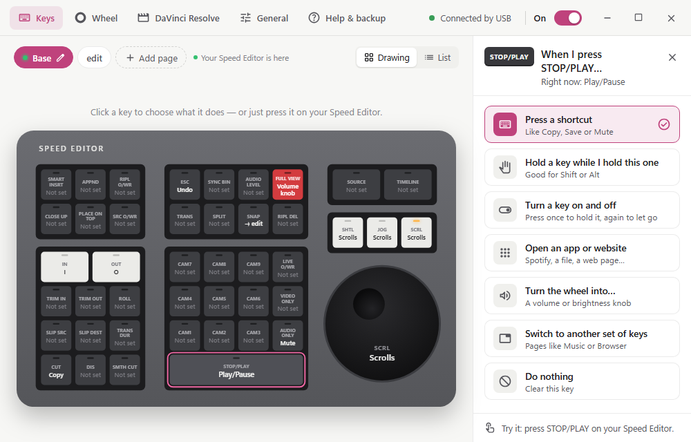
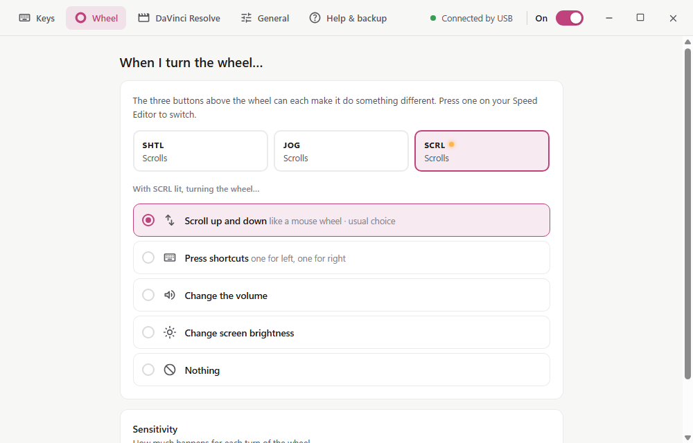
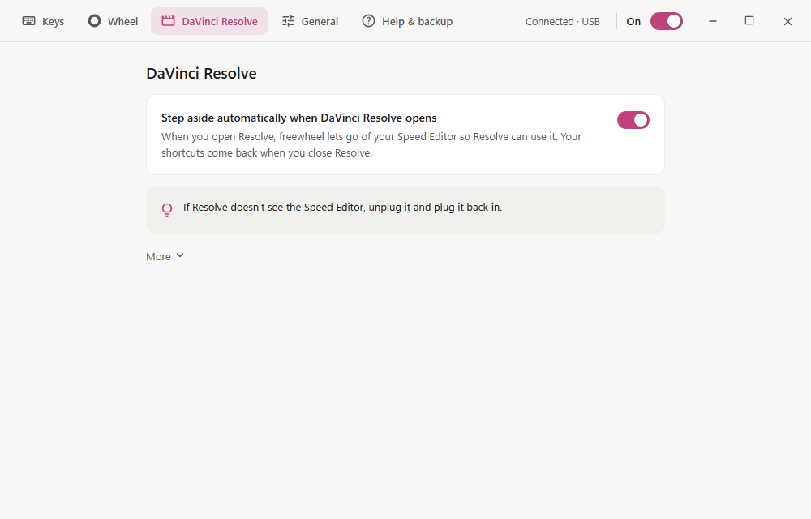
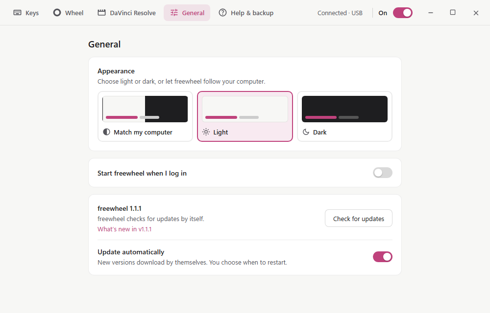
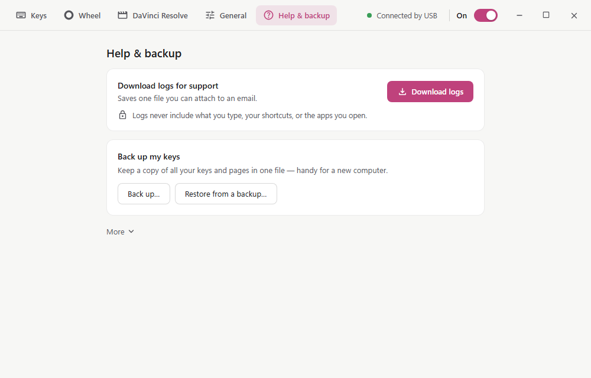
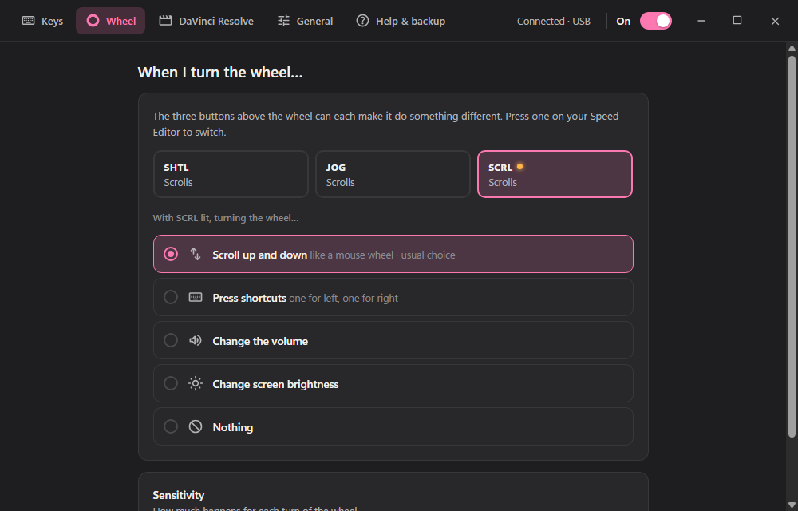

# freewheel

Use a Blackmagic Speed Editor with any app, without DaVinci Resolve.

<picture>
  <source media="(prefers-color-scheme: dark)" srcset="docs/images/dark-keys.png">
  
</picture>

## What it does

- **Remap every key** to a keyboard shortcut, a media key (Play/Pause, Mute,
  volume), an app, a file or a website.
- **Pages**: give the keys several sets of jobs and switch between them with a
  key.
- **Wheel modes**: Jog, Shuttle and Scroll, or turn the wheel into a knob for
  system volume, the focused app's volume or screen brightness.
- **Steps aside for DaVinci Resolve**: while Resolve is open freewheel lets go
  of the Speed Editor, and takes it back when Resolve closes.
- **Key lights** follow what is on: the wheel mode, toggled keys, the page.
- **Lives in the tray** (the menu bar on macOS): switch it Off and On, check
  for updates, open settings.
- **Portable**: one file you download and run, nothing to install.
- **Small**: measured on Windows CI, about 31 MB of memory and 0.15% of one
  CPU core when idle in the tray, from a 14.5 MB exe.

Works over USB and Bluetooth, on Windows 11 and macOS 15 (Apple Silicon and
Intel).

## Download and run

Download the file for your system from
[Releases](https://github.com/brinkercode/freewheel/releases/latest) and run
it. There is no installer.

- **Windows**: download `freewheel-<version>-windows-x64.exe` and run it. Keep
  it anywhere you can write to (Downloads, Documents, Desktop, a USB stick;
  not Program Files) so it can update itself. The exe is not code-signed, so
  SmartScreen may ask the first time: **More info**, then **Run anyway**.
- **macOS**: download `freewheel-<version>-macos-universal.dmg`, open it and
  run freewheel, or drag it onto the Applications folder next to it to keep
  it (and let it update itself: it can't from the open .dmg). It is not
  notarized yet, so macOS blocks the first open: go to
  **System Settings → Privacy & Security**, click **Open Anyway** next to
  freewheel and confirm. Then allow freewheel under **Accessibility** and
  **Input Monitoring** (setup asks and takes you there): it needs them to
  send keys and read the Speed Editor.
- **Linux**: download the `.AppImage`, make it executable (`chmod +x`, or
  Properties → Allow executing as a program) and double-click it. The first
  start asks once for permission to use the Speed Editor.

The first start walks you through connecting the Speed Editor by cable or
Bluetooth. Settings are kept in your user folder (`%APPDATA%\freewheel` on
Windows, `~/Library/Application Support/freewheel` on macOS), not next to the
app, so moving or replacing the app keeps them. To remove freewheel, quit it,
turn off **Start freewheel when I log in**, and delete the file (on macOS,
freewheel.app).

## Updates

freewheel checks GitHub for a newer release when it starts and when you click
**Check for updates** (General tab). With **Update automatically** on (the
default) it downloads the new version's file for your system, verifies its
signature against the key built into your copy, and offers **Restart to
update**. That puts the new version in place of the one you run (same file,
same name, same place), restarts, shows what's new, and deletes the old copy
and the download. Your settings are kept. If any step fails,
the version you have keeps running. Turn **Update automatically** off to be
asked before the download.

## Screens

| Wheel | DaVinci Resolve |
| --- | --- |
|  |  |
| **General** | **Help & backup** |
|  |  |
| **Dark mode** | |
|  | |

## Back up and restore

**Help & backup → Back up…** saves your keys, pages and wheel settings to
`freewheel-mappings.json`. **Restore from a backup…** asks before it replaces
anything and keeps a copy of your current settings first.

A backup can hold keys that open apps. Restored keys that open apps stay off
unless you turn on **Let restored keys open apps**: leave it off for a file
someone sent you.

Write or edit a mappings file by hand: see [SCHEMA.md](SCHEMA.md).

## Troubleshooting

- **Help & backup → More → Device test** shows the connection, the unlock
  handshake, the battery and every key and wheel report live; **Copy
  diagnostics** copies it all as text.
- **Download logs** (Help & backup, or the tray) saves a log bundle to your
  Downloads folder; attach it to a
  [bug report](https://github.com/brinkercode/freewheel/issues/new/choose).
  Turn on **detailed logs** first for more detail.
- A step-by-step USB and Bluetooth test: [docs/device-testing.md](docs/device-testing.md).

## Building from source

See [docs/development.md](docs/development.md).

## Releasing

Releases are made with [release-please](https://github.com/googleapis/release-please)
from conventional commits: see [docs/releasing.md](docs/releasing.md). Before
a release is published it is checked on real hardware with the
[release checklist](.github/ISSUE_TEMPLATE/release-checklist.md).

## Privacy

No telemetry, no accounts, no analytics. freewheel's only network requests
are for updates, to GitHub, over HTTPS:

1. the release manifest,
   `https://github.com/brinkercode/freewheel/releases/latest/download/latest.json`,
   at start and when you click **Check for updates**;
2. the file for your system that the manifest lists (the exe, the .dmg or
   the AppImage of the same GitHub release), only when an update is
   downloaded.

Builds without the release's update key (built from source, CI test builds)
make no requests at all. Links you click (What's new, a key set to open a
website) open in your browser.

## License and credits

MIT, see [LICENSE](LICENSE). Credits are in [NOTICE](NOTICE):

- The Speed Editor's authentication is ported from `bmd.py` in
  [smunaut/blackmagic-misc](https://github.com/smunaut/blackmagic-misc)
  (Apache 2.0), whose reverse-engineering of the device's protocol informs
  freewheel's device code.
- UI icons are [Material Symbols](https://github.com/google/material-design-icons)
  (Apache 2.0).

freewheel is not affiliated with Blackmagic Design. Speed Editor and DaVinci
Resolve are trademarks of Blackmagic Design.
