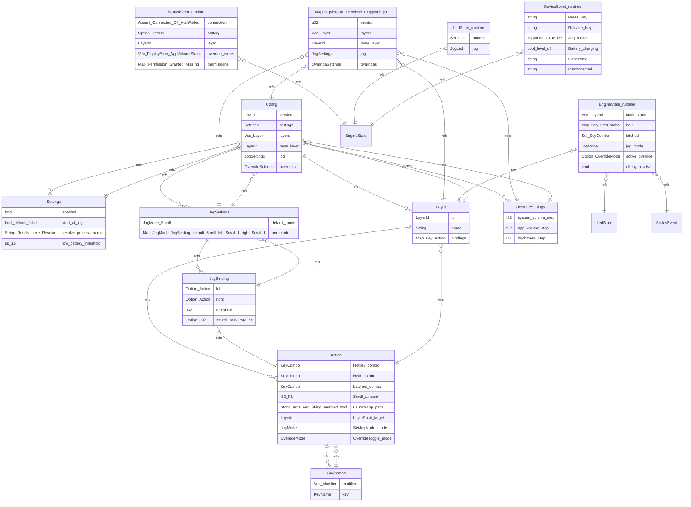

# freewheel data model

## Config

| field | type |
| --- | --- |
| version | u32 (1) |
| settings | Settings |
| layers | Vec<Layer> |
| base_layer | LayerId |
| jog | JogSettings |
| overrides | OverrideSettings |

Refers to: Settings, Layer, JogSettings, OverrideSettings

## Settings

| field | type |
| --- | --- |
| enabled | bool |
| start_at_login | bool (default false) |
| resolve_process_name | String (Resolve.exe \| Resolve) |
| low_battery_threshold | u8 (15) |

Refers to: Config

## Layer

| field | type |
| --- | --- |
| id | LayerId |
| name | String |
| bindings | Map<Key, Action> |

Refers to: Config, Action

## Action

| field | type |
| --- | --- |
| Hotkey{combo | KeyCombo} |
| Held{combo | KeyCombo} |
| Latched{combo | KeyCombo} |
| Scroll{amount | i32} (P1) |
| LaunchApp{path | String, args: Vec<String>, enabled: bool} |
| LayerPush{target | LayerId} |
| SetJogMode{mode | JogMode} |
| OverrideToggle{mode | OverrideMode} |

Refers to: KeyCombo, Layer

## KeyCombo

| field | type |
| --- | --- |
| modifiers | Vec<Modifier> |
| key | KeyName |

Refers to: Action

## JogSettings

| field | type |
| --- | --- |
| default_mode | JogMode (Scroll) |
| per_mode | Map<JogMode, JogBinding> (default Scroll: left Scroll(-1), right Scroll(+1)) |

Refers to: JogBinding, Config

## JogBinding

| field | type |
| --- | --- |
| left | Option<Action> |
| right | Option<Action> |
| threshold | u32 |
| shuttle_max_rate_hz | Option<u32> |

Refers to: Action, JogSettings

## OverrideSettings

| field | type |
| --- | --- |
| system_volume_step | f32 |
| app_volume_step | f32 |
| brightness_step | u8 |

Refers to: Config

## DeviceEvent (runtime)

| field | type |
| --- | --- |
| Press(Key) | string |
| Release(Key) | string |
| Jog{mode | JogMode, value: i32} |
| Battery{charging | bool, level: u8} |
| Connected | string |
| Disconnected | string |

Refers to: EngineState

## EngineState (runtime)

| field | type |
| --- | --- |
| layer_stack | Vec<LayerId> |
| held | Map<Key, KeyCombo> |
| latched | Set<KeyCombo> |
| jog_mode | JogMode |
| active_override | Option<OverrideMode> |
| off_by_resolve | bool |

Refers to: Layer, LedState, StatusEvent

## LedState (runtime)

| field | type |
| --- | --- |
| buttons | Set<Led> |
| jog | JogLed |

Refers to: EngineState

## StatusEvent (runtime)

| field | type |
| --- | --- |
| connection | Absent\|Connected\|Off\|AuthFailed |
| battery | Option<Battery> |
| layer | LayerId |
| override_errors | Vec<DisplayError\|AppVolumeStatus> |
| permissions | Map<Permission, Granted\|Missing> |

Refers to: EngineState

## MappingsExport (freewheel-mappings.json)

| field | type |
| --- | --- |
| version | u32 |
| layers | Vec<Layer> |
| base_layer | LayerId |
| jog | JogSettings |
| overrides | OverrideSettings |

Refers to: Config, Layer, JogSettings, OverrideSettings

