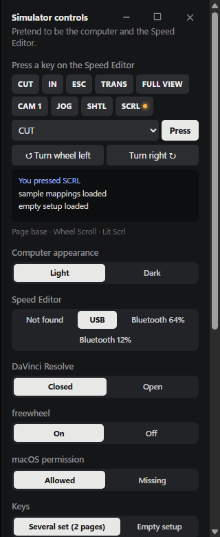

# Developing freewheel

freewheel is a [Tauri 2](https://tauri.app) app: a React settings window
(`src/`) on a Rust core (`crates/freewheel-core`: config, the Speed Editor
protocol, the engine) and the app shell (`src-tauri`: device, tray, key
injection, updates).

## Set up

You need Node 22 and the Rust version in [rust-toolchain.toml](../rust-toolchain.toml)
(`rustup` installs it for you). On Linux, Tauri's system packages are needed
for the app itself; the tests and the UI build run without them.

```sh
npm ci
npx tauri dev -- -- --simulate   # the app with the simulator, no device needed
npx tauri dev                    # the app with a real Speed Editor
```

## The simulator

`--simulate` starts freewheel with a simulated Speed Editor instead of the
real one and opens a second window that drives it: connect over USB or
Bluetooth, disconnect, set the battery, press and release every key, turn the
wheel in each mode, open and close DaVinci Resolve, publish a fake update,
click the tray menu's items, and jump the settings window to any screen.
**Several set** loads sample keys on two pages.

- The simulator keeps its own config in a `simulator` folder inside the
  normal config folder, so your real keys are never read or changed.
- Key injection is off: each action shows in the Simulator's log (e.g.
  `would press Ctrl+C`). Tick **Send for real** to send it to the focused app.
- Window titles contain "Simulator".

On Windows, `freewheel-simulate.cmd` (in `src-tauri/windows/`, and an
artifact of its own next to the `freewheel.exe` artifact in the test-build
and e2e runs: download both into one folder) starts `freewheel.exe
--simulate` with a double-click. Releases do not include it.



## Tests

```sh
npm test                                     # UI and script tests (vitest)
npm run build                                # the UI bundle
cargo fmt --check
cargo clippy --workspace -- -D warnings
cargo test --workspace
```

CI ([ci.yml](../.github/workflows/ci.yml)) runs these on Linux, Windows and
macOS (Apple Silicon and Intel).

## Profile icons

A profile's icon is any Material Symbols Rounded icon, by its name
(`edit`, written `:edit:` in the mappings file; see
[SCHEMA.md](../SCHEMA.md#profile-icons) and the
[catalogue](https://fonts.google.com/icons?icon.style=Rounded)). The whole
set is bundled, so nothing is fetched:

- `src/assets/symbols/symbols.woff2`: the font (about 300 KB), one static
  style (weight 400, unfilled, optical size 24, like the SVG icons in
  `src/assets/icons`). The UI draws an icon by its codepoint
  (`src/symbols.js`, `SymbolIcon` in `src/Icon.jsx`).
- `crates/freewheel-core/src/icon_names.txt`: every name and its codepoint.
  The Rust side checks names with it (`crates/freewheel-core/src/icons.rs`)
  and the profile editor's search reads the same file.

To update both, download Google's static Rounded woff2 for that style and
run `scripts/icons/build-icon-font.py` (fonttools; the usage is at its top),
then bump the font version in NOTICE.

## End-to-end tests (Windows)

[e2e-windows.yml](../.github/workflows/e2e-windows.yml) builds the real
`freewheel.exe`, starts it with `--simulate` under WebDriver and clicks
through the first run, every tab, the key panel and every Simulator and tray
control ([scripts/e2e-windows.mjs](../scripts/e2e-windows.mjs)). Every step
is screenshotted into the `e2e-screenshots` artifact; its `readme/` folder
holds the stills used in the README (`docs/images/`). The same workflow
measures the footprint (memory, CPU, size) and runs a full portable update
against a local release server.

To refresh the screenshots, download `e2e-screenshots` from a green run,
copy the `readme/` stills the README and this page use into `docs/images/`
(`light-simulator.png` is `simulator.png` here) and optimise them losslessly
(e.g. oxipng).

## Linux

- Tauri's packages: `libwebkit2gtk-4.1-dev libayatana-appindicator3-dev
  librsvg2-dev libssl-dev` (Ubuntu/Debian names). Key injection uses XTest on
  X11 and a uinput virtual keyboard elsewhere; the Speed Editor's hidraw node
  and `/dev/uinput` need the device rule (`src-tauri/linux/`), which the
  first run installs through `pkexec`.
- [e2e-linux.yml](../.github/workflows/e2e-linux.yml) runs the same
  click-through as Windows ([scripts/e2e.mjs](../scripts/e2e.mjs), platform
  `linux`) under Xvfb with openbox, over tauri-driver and WebKitWebDriver; the
  footprint job ([scripts/footprint-linux.mjs](../scripts/footprint-linux.mjs))
  measures RSS and private memory of freewheel plus its WebKitGTK processes,
  idle CPU and disk against
  [footprint-budgets-linux.json](../scripts/footprint-budgets-linux.json);
  the update job builds two AppImages and updates one to the other in place
  from a local release server ([scripts/e2e-update-linux.mjs](../scripts/e2e-update-linux.mjs)).
- Locally: `xvfb-run -a dbus-run-session -- sh -c 'openbox & node
  scripts/e2e-linux.mjs --app target/release/freewheel --tauri-driver
  ~/.cargo/bin/tauri-driver --native-driver /usr/bin/WebKitWebDriver'` after
  `npm run build` and `cargo build --release -p freewheel --features
  tauri/custom-protocol,e2e`.
- The release ships an AppImage built on Ubuntu 22.04 (an older glibc). It
  updates itself in place: the file the user started (`$APPIMAGE`) is
  swapped for the verified new one (`<name>.new`, then the running one to
  `<name>.old`), and start at login points at that same path.
- Closed to the tray, freewheel ends WebKitGTK's network process and trims
  its heap (`src-tauri/src/linux_idle.rs`); the next window starts a new one.

## Test builds

Every push to main builds a portable Windows exe (with
`freewheel-simulate.cmd`); see [releasing.md](releasing.md#test-builds).
